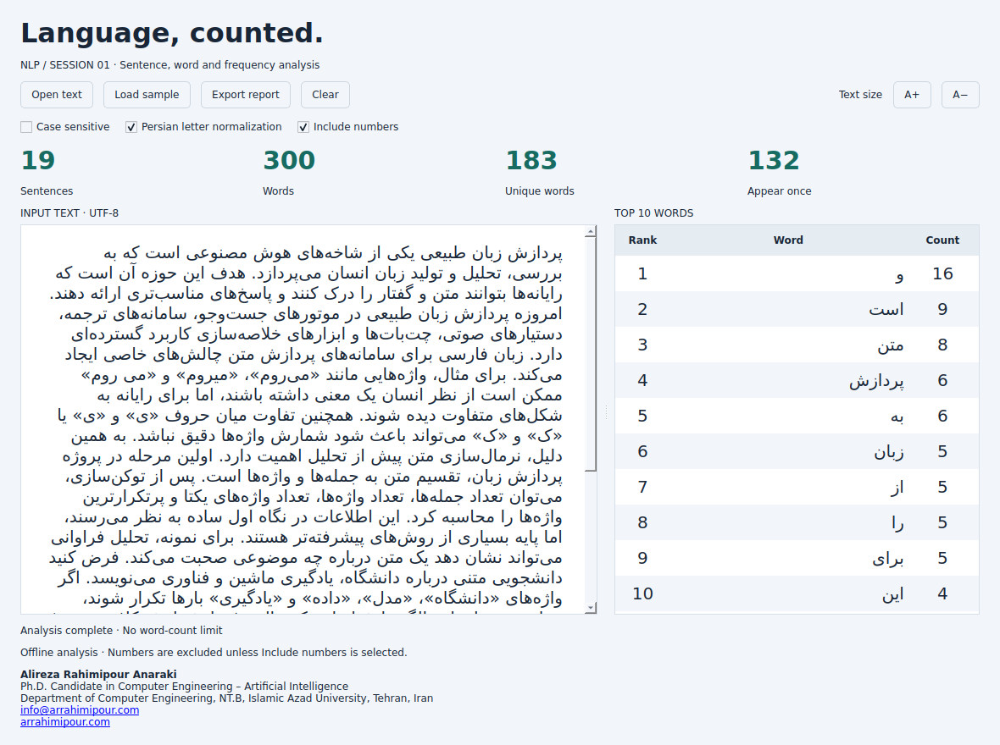

# NLP Text Analyzer

A Python desktop app and CLI for text analysis **and optional, inspectable Session 2 preprocessing**: HTML/noise cleanup, multilingual Unicode, social text, privacy masking and dataset filtering.

The project started with the first-session NLP assignment: choose a 300-word text and extract sentence counts, vocabulary size, and the ten most frequent words. The application now accepts texts of any length. The original 300-word example is still included so there is an easy result to check against.

**Author:** Alireza Rahimipour Anaraki

**Git identity:** `ARRahimipour <arrahimipourdev@gmail.com>`

## What the app does

- Counts sentences, word tokens, distinct words, and words that occur only once.
- Lists the ten most frequent words; tied counts follow their first appearance in the text.
- Handles UTF-8 files and pasted text, including Persian and Arabic.
- Uses a Qt editor for right-to-left text, mixed scripts, and automatic line wrapping.
- Offers optional Persian letter normalization and numeric-token counting.
- Adds task presets (general, sentiment, topic, NER, transformer, spam), advanced cleaning controls, and a cleaned-text preview that never edits your input.
- Handles HTML entities/script/style, URLs, emails, mentions, hashtags, punctuation, invisible controls, emoji, digits and PDF-like broken lines.
- Can clean `.csv`, `.tsv`, and `.jsonl` datasets, filter records, deduplicate and produce an audit summary.
- Exports HTML, JSON, CSV, or a plain-text report.

Text analysis runs locally. No text is sent to a service, and no language model or API key is needed.

## Setup

Use **Python 3.12** if possible; that is the version used for verification. The code requires Python 3.10 or newer, but the pinned Qt release also needs a compatible wheel for your Python version and operating system. Very new Python releases may need a different Qt version. Start with Python 3.12 if installation fails.

Extract the ZIP and open a terminal in the directory containing `main.py`. If you want the Git history as well, first follow [Restoring the repository](#restoring-the-repository) below and work in the cloned directory.

### Recommended: create the environment with the helper

On Windows:

```powershell
py -3.12 setup_env.py
py -3.12 run_gui.py
```

If `python` already points to Python 3.12, these commands work too:

```bash
python setup_env.py
python run_gui.py
```

On macOS or Linux:

```bash
python3 setup_env.py
python3 run_gui.py
```

`setup_env.py` creates `.venv` next to `main.py` and installs the pinned requirements there. Running it again reuses that environment. `run_gui.py` always launches the Python executable inside this project's `.venv`, even when the shell has not activated it. Both helpers resolve paths relative to their own files.

The initial installation needs internet access. After that, the application works offline. `.venv` is intentionally excluded from Git and the release ZIP: virtual environments contain platform-specific executables and should be created on the machine that will use them.

### Manual setup on Windows

PowerShell:

```powershell
py -3.12 -m venv .venv
.\.venv\Scripts\Activate.ps1
python -m pip install -r requirements.txt
python main.py --gui
```

Command Prompt uses a different activation command:

```bat
.venv\Scripts\activate.bat
```

If PowerShell blocks activation, there is no need to change its execution policy. Call the environment's interpreter directly:

```powershell
.\.venv\Scripts\python.exe -m pip install -r requirements.txt
.\.venv\Scripts\python.exe main.py --gui
```

### Manual setup on macOS or Linux

```bash
python3 -m venv .venv
source .venv/bin/activate
python -m pip install -r requirements.txt
python main.py --gui
```

Run `deactivate` when you want to leave an activated environment. Some Linux distributions package venv support separately; if creation fails because `ensurepip` is missing, install the venv package for your Python version.

### Check which Python you are using

After activation:

```bash
python -c "import sys; print(sys.executable); print(sys.prefix != sys.base_prefix)"
```

The path should point inside this project's `.venv`, and the second line should be `True`.

For command-line-only use, `python setup_env.py --cli-only` creates the environment without downloading Qt. The analysis engine and report exporters use only Python's standard library.

## Using the desktop

Open the application with `python run_gui.py`. The window title should show **v2.0**.

1. Choose **Open text**, paste a passage, or select **Load sample**.
2. Read the four totals above the editor and the frequency table on the right.
3. Enable **Persian letter normalization** when Arabic and Persian letter variants should count together.
4. Enable **Include numbers** if standalone numbers should contribute to the word total.
5. Select **Export report** and choose a filename and format.
6. Optionally choose a **Session 2 cleaning preset**. Edit emoji/punctuation/number behavior, PII masking, and other controls, and review the **cleaned preview** below the unchanged source editor. Use **Clean dataset** to choose a CSV/TSV/JSONL file and a separate output file (default text column: `text`).

Counts update after a short typing pause. **A+** and **A−** change the editor and table font sizes. Ctrl+O opens a file; Ctrl+S exports a report. The interface labels remain English while the editor sets direction separately for each paragraph. The text is stored in its original logical order, so display formatting does not reverse it or insert hidden directional characters.



This is the older Session 1 interface. Version 2 adds the cleaning controls,
cleaned-text preview and dataset action described above; its updated GUI has
not been re-rendered in this environment. Fonts and dialogs vary by OS.

## Examples and expected counts

These commands assume `.venv` is activated. You can also replace `python` with the full path to its interpreter.

```bash
python main.py examples/english_300.txt
python main.py examples/persian_regression.txt --persian --include-numbers
```

| Input and options | Sentences | Words | Unique words | Occur once |
| --- | ---: | ---: | ---: | ---: |
| English sample, defaults | 26 | 300 | 207 | 166 |
| Persian regression, `--persian` | 19 | 298 | 181 | 130 |
| Persian regression, `--persian --include-numbers` | 19 | 300 | 183 | 132 |

The two extra Persian-example tokens are `۱۴۰۵` and `2026`. This explains why a count can change from 298 to 300 without any text being added. Persian normalization also changes vocabulary counts when different spellings of the same letter are merged.

The Persian example includes quoted punctuation such as `«؟»` and `«!»`. Those are examples of symbols inside a sentence, so they do not create additional sentence boundaries.

## Command-line use

```bash
python main.py my_text.txt
python main.py --text "Hello world! Hello NLP."
python -m nlp_analyzer examples/english_300.txt
python main.py examples/persian_regression.txt --persian --include-numbers --format html --output outputs/report.html
python main.py examples/english_300.txt --format json --output outputs/report.json
python main.py examples/english_300.txt --format csv --output outputs/vocabulary.csv
python main.py --text '<p>سالااام 😍 #NLP!</p>' --clean-preset topic --format json
python main.py --text 'Email: ali@example.com' --clean-preset general --mask-pii --format html
python main.py dataset.csv --dataset --clean-preset general --mask-pii --text-column text --output dataset_cleaned.csv
python main.py dataset.jsonl --dataset --clean-preset topic --near-duplicate 0.90 --min-persian-script-ratio 0.5 --output dataset_cleaned.jsonl
```

When no file or `--text` argument is supplied, the CLI reads standard input. Files must be UTF-8. Warnings go to stderr so JSON on stdout stays usable by another program.

| Option | Purpose |
| --- | --- |
| `--top N` | Show up to N frequent words; default 10 |
| `--case-sensitive` | Keep uppercase and lowercase variants separate |
| `--persian` | Normalize Arabic yeh, alef maksura, and kaf to Persian forms; remove tatweel |
| `--include-numbers` | Count tokens containing only numbers |
| `--format text/json/csv/html` | Choose the report format; default text |
| `--output PATH` | Save the report instead of printing it |
| `--gui` | Open the desktop; requires the Qt dependency |
| `--clean-preset general/sentiment/topic/ner/transformer/spam` | Opt in to an adjustable Session 2 cleaning pipeline |
| `--emoji keep/remove/label` | Keep, remove, or add Unicode-derived text labels for emoji |
| `--punctuation keep/normalize/remove` | Control punctuation without losing original sentence boundaries |
| `--number-mode keep/remove/placeholder` | Preserve numbers or replace them with `<NUM>` |
| `--digit-style keep/ascii/persian` | Normalize different decimal-digit scripts |
| `--invisible none/safe/controls` | Remove select hidden direction characters or also ASCII controls; ZWNJ and ZWJ remain |
| `--mask-pii` | Mask emails, Iranian mobile formats, and 10-digit numeric identifiers |
| `--keep-urls`, `--keep-mentions`, `--keep-hashtag-marker` | Override preset behavior |
| `--remove-diacritics`, `--join-broken-lines` | Optional Arabic diacritic removal and PDF-like line joining |
| `--reduce-elongations`, `--keep-elongations` | Choose conservative repeated-letter reduction or retain source forms |
| `--remove-retweets`, `--keep-retweets`, `--keep-html` | Override social/HTML handling |
| `--dataset` | Clean rows in a CSV, TSV, or JSONL file (requires `--output`) |
| `--text-column`, `--min-length`, `--max-length` | Pick text field and length limits (defaults: `text`, 3, 5000) |
| `--min-persian-script-ratio 0..1` | Filter on a simple Arabic-script character ratio (not a language detector) |
| `--keep-duplicates`, `--near-duplicate 0.7..1` | Adjust exact/heuristic near-duplicate filtering |

A successful CLI analysis returns exit code 0. Invalid arguments or file errors return 2. There is no target word count and no PASS/CHECK grading status. The desktop has its own controls; CLI analysis flags are not used to initialize those controls.

### What each export contains

| Format | Contents |
| --- | --- |
| HTML | Totals, frequency bars, sentence audit, vocabulary, options, and author details |
| JSON | All metrics, tokens, sentences, frequencies, warnings, options, cleaned text, and stage statistics |
| CSV | The full vocabulary frequency table, with `word` and `count` columns |
| Text | Totals, most frequent words, selected options, and author details |

HTML bars are scaled against the most frequent word, not against the total word count. Existing output files may be replaced after you choose them; the app prevents exporting over the source text file itself.

## How counting works

Without a preset, the original Session 1 path stays unchanged: normalize the text, find sentence boundaries, extract tokens, and build a frequency table with `collections.Counter`. With cleaning enabled, a configurable cleaning pipeline runs first, and punctuation-sensitive sentence splitting uses a snapshot **before** destructive punctuation removal. Neither mode removes stopwords, stems words, or tries to infer meaning; those topics follow after slide 17.

A **word token** contains Unicode letters or numbers and their attached marks. Unless numbers are enabled, a token must contain at least one letter. Internal apostrophes and Persian joining characters are retained: `don't` and `می‌روم` each count as one token. Hyphens separate tokens, so `well-known` counts as two. With numeric counting enabled, `3.14` is two numeric tokens because the decimal point separates them; the sentence splitter still protects that decimal point.

**Unique words** means the number of distinct normalized tokens. **Occur once** means tokens whose frequency is exactly one. These are different metrics. For `hello hello world`, the total is 3, the vocabulary size is 2, and only 1 word occurs once.

By default, case folding merges `Hello` and `HELLO`. NFC normalization also merges equivalent Unicode sequences. Session 2 presets additionally use NFKC and Persian letter normalization; diacritic removal and digit conversion are optional. The program does not infer missing spaces or merge `می روم`, `میروم`, and `می‌روم` into one spelling. Repeated-character reduction is only a heuristic (for example, `سالااام` becomes `سالام`, **not** a dictionary-corrected `سلام`).

Sentence splitting recognizes common terminal punctuation, protects decimal points and some English abbreviations, and ignores punctuation-only examples inside balanced quotes. Blank lines separate fragments; single line wraps do not. A final fragment without terminal punctuation counts as a sentence.

These are explicit rules, not a full linguistic parser. Uncommon abbreviations, quoted dialogue, ellipses, and missing punctuation can still require review. Chinese, Japanese, Thai, and similar scripts need language-specific lexical segmentation; this program accepts their Unicode text but treats uninterrupted runs as tokens and warns for detected unspaced-script ranges. It does not promise exact word counts in every language.

The supplied lecture mentions Python and NLTK. This implementation uses the standard library for the covered cleaning and counting stages, so no tokenizer model downloads are needed. It is not an NLTK/Hazm model implementation. Approximate duplicate detection is a candidate-based heuristic, not a proof that train/test leakage is absent. PII masking is pattern-based; names and data in other dataset columns are not automatically anonymized. Source files and GUI input are kept unchanged; saving a report may include cleaned text and should be reviewed before sharing.

See [Session 2 coverage through slide 17](docs/SESSION2_TO_SLIDE17.md) for all covered slide topics, design choices and limitations.

## Tests

From the activated environment:

```bash
python -m unittest discover -s tests -v
```

There are **86 tests**, covering the original functionality plus HTML, Unicode, controls, emoji, privacy, presets, data cleansing, duplicate detection and exports. Ten tests exercise real Qt widgets in offscreen mode; without Qt, those ten are skipped.

See [verification details](docs/VERIFICATION.md) and the captured [test output](docs/test-results.txt). The current release was checked in an isolated Python 3.12 environment on Linux. Windows installation commands are documented but have not been run here.

## Project structure

| Path | Responsibility |
| --- | --- |
| `main.py` | Main CLI and `--gui` entry point |
| `setup_env.py` | Creates `.venv` and installs project requirements |
| `run_gui.py` | Starts the desktop through the local environment |
| `requirements.txt` | Complete desktop installation entry point |
| `requirements-gui.txt` | Pinned Qt and binding dependencies |
| `nlp_analyzer/core.py` | Normalization, tokenization, counts |
| `nlp_analyzer/preprocessing.py` | Session 2 configurable clean-text stages and audits |
| `nlp_analyzer/dataset.py` | CSV/TSV/JSONL row filters, deduplication and summaries |
| `nlp_analyzer/direction.py` | Unicode direction detection |
| `nlp_analyzer/gui.py` | Qt desktop interface |
| `nlp_analyzer/reports.py` | Export rendering |
| `examples/` | Input texts and reproducible reports |
| `tests/` | Unit and integration tests |
| `docs/` | Design notes, verification, and development instructions |

## Troubleshooting

**`No module named PySide6`:** install with `.venv`'s interpreter: `python -m pip install -r requirements.txt` after activation. Then use `python run_gui.py`. Installing globally does not install into the project's environment.

**The old interface still appears:** close all running copies and launch from the new project directory. Check the version in the window title.

**The text has fewer words than expected:** check **Include numbers** first. Also check the documented handling of hyphens, punctuation, and Persian spaces versus half-spaces.

**A UTF-8 error appears:** save the input file as UTF-8 in your editor. The application does not guess legacy encodings.

**A moved environment no longer works:** create a new `.venv` in the final project location. Do not copy one from a different machine or operating system.

**A test is skipped:** the Qt tests skip when the optional desktop dependency is unavailable. Check `python -m pip show PySide6-Essentials` in the same environment used to run tests.

## Restoring the repository

The supplied ZIP contains the `.git` directory itself, including the original
commit history. Unzip it and run commands in the extracted project directory:

```bash
git status
git log --oneline -5
python setup_env.py
```

The Session 2 changes are supplied as working-tree modifications; they are not
committed to the original history. Existing commits retain their metadata.
No remote repository has been created or pushed.

For change and dependency workflows, see [development notes](docs/DEVELOPMENT.md).

## Author

**Alireza Rahimipour Anaraki**

Ph.D. Candidate in Computer Engineering – Artificial Intelligence

Department of Computer Engineering, NT.B, Islamic Azad University, Tehran, Iran

[info@arrahimipour.com](mailto:info@arrahimipour.com) · [arrahimipour.com](https://arrahimipour.com)
